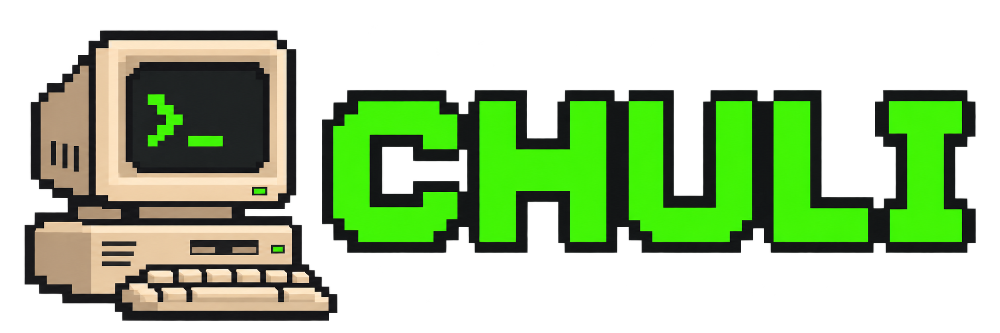
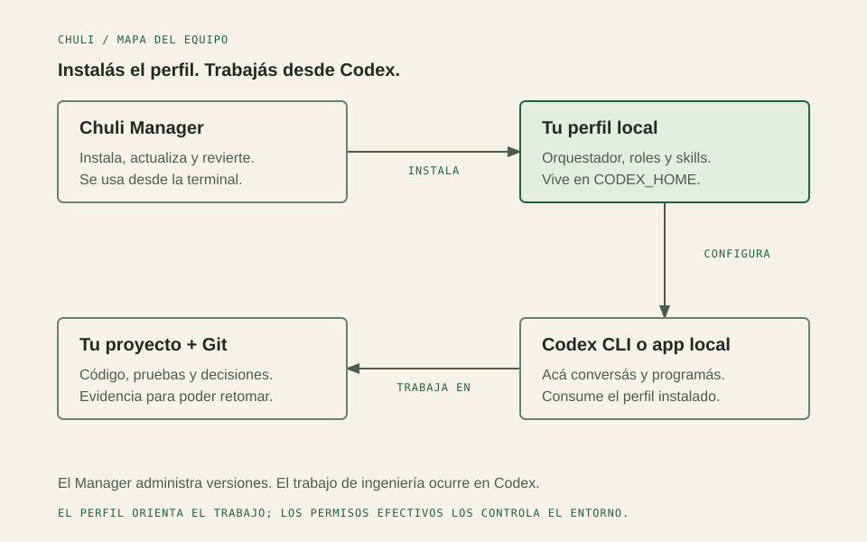
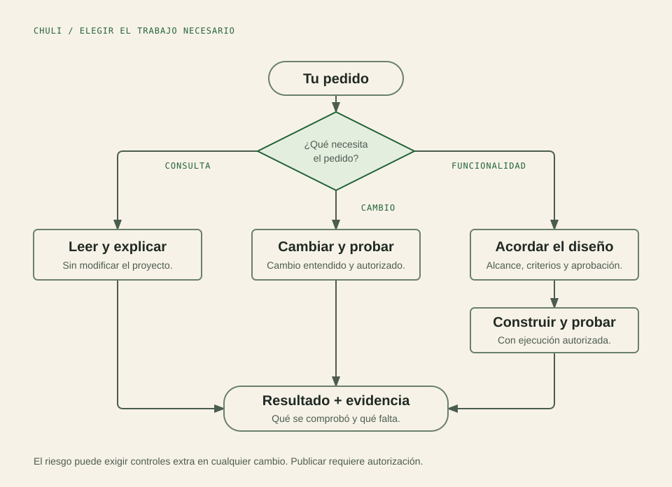

# Chuli

**Un perfil de ingeniería para el Codex que ya usás.**

De la idea al cambio comprobado, con decisiones claras y un compañero que te explica mientras trabajan.

[Descargar](https://github.com/AlejoPalavecino/codex-engineering-harness/releases/latest) · [Qué es](#que-es) · [Instalación](#instalacion) · [Cómo trabaja](#como-trabaja) · [Componentes](#componentes) · [Documentación](#documentacion)

**6 especialistas · decisiones claras · documentación para compartir**

---

## 00 · Qué estás instalando

Chuli es un **perfil de ingeniería para Codex**: instrucciones para coordinar el trabajo, especialistas para tareas concretas y procedimientos que el agente consulta cuando hacen falta. Está pensado para construir y mantener un proyecto con decisiones, cambios y comprobaciones que otra persona pueda entender.

**El recorrido:** abrís el Manager para instalar o actualizar el perfil; después abrís Codex en tu proyecto y trabajás ahí. El Manager no dirige cada etapa de desarrollo. El orquestador corre dentro de la sesión de Codex y te ayuda a decidir qué hace falta investigar, acordar, implementar o verificar.

| Parte | Dónde está | Qué hace |
| --- | --- | --- |
| **Chuli Manager** | El ejecutable `chuli` / `chuli.exe` | Descarga, instala, verifica, actualiza y revierte el perfil. |
| **Perfil de Chuli** | Tu `CODEX_HOME`, normalmente `~/.codex` | Contiene instrucciones, configuración de roles, skills y recursos. |
| **Tu sesión de Codex** | Codex CLI o el modo Codex local de la app de escritorio | Es donde conversás, el agente usa herramientas y se modifica el proyecto autorizado. |
| **Tu proyecto** | El repositorio donde estás trabajando | Conserva código, pruebas y documentación; en trabajo sustancial, decisiones y seguimiento para retomar. |

[Fuente del diagrama](assets/diagrams/chuli-architecture.html) · [Operaciones del Manager](docs/TUI.md) · [Responsabilidad de cada componente](docs/protocols/TKA.md)

## 01 · Encendé el equipo

**Necesitás Python 3.11 o posterior y PowerShell para aplicar el perfil.**

1. **Descargá el Manager** desde la [última release estable](https://github.com/AlejoPalavecino/codex-engineering-harness/releases/latest).
2. **Extraé y abrí el ejecutable:** `chuli.exe` en Windows o `chuli` en Linux/macOS.
3. **Elegí instalar desde la última release.** Revisá el destino y los cambios, y confirmá. El Manager descarga el perfil y verifica su SHA-256.
4. **Abrí una sesión nueva de Codex** en tu proyecto y empezá con una tarea concreta.

| Tu equipo | Archivo del Manager |
| --- | --- |
| Windows x64 | `chuli_v<versión>_windows_amd64.zip` |
| Linux x64 | `chuli_v<versión>_linux_amd64.tar.gz` |
| macOS ARM64 | `chuli_v<versión>_darwin_arm64.tar.gz` |

La [guía de instalación](docs/INSTALLATION.md) cubre requisitos, personalizaciones, actualización, verificación y rollback. Los cuatro artefactos de cada release se acompañan de `SHA256SUMS.txt` para comprobar las descargas.

> **¿Ya tenés un perfil personalizado?** Revisá la vista previa antes de aplicar. Chuli tiene reglas para preservar archivos ajenos y recursos personalizados; reemplazarlos requiere una decisión explícita. Consultá la guía antes de actualizar.

## 02 · Del pedido al resultado

El orquestador es el punto de contacto: conversa con vos, revisa el contexto y elige cuánto proceso necesita el pedido. Habla en español argentino, explica primero en palabras cotidianas y suma el concepto técnico cuando te sirve para aprender.

| Vos necesitás… | Chuli trabaja así |
| --- | --- |
| Entender código o evaluar una idea | Investiga y explica con referencias. Una consulta mantiene el trabajo en lectura. |
| Corregir algo puntual | Inspecciona, hace el cambio autorizado y ejecuta una comprobación proporcionada. |
| Construir una funcionalidad | Aclara decisiones pendientes, propone el diseño y conserva tareas y evidencia cuando hace falta continuidad. |
| Diseñar una interfaz | Parte de la tarea de la persona, define estados y prepara un guion para comprobar apariencia, interacción y resultado. |

Pregunta por decisiones que cambian el resultado y resuelve detalles técnicos reversibles dentro del alcance autorizado. Esa autorización acompaña la implementación, las correcciones y la verificación. Si cambia el alcance, vuelve a consultar lo afectado.

El riesgo se evalúa aparte del tamaño: un cambio pequeño de permisos puede necesitar controles adicionales. Aprobar un diseño y autorizar su implementación son decisiones distintas. Publicar, hacer push, abrir una PR, integrar o desplegar requieren la autorización aplicable.

Usa TDD cuando hay una prueba adecuada y procura unidades revisables de unas 400 líneas, con código, pruebas y documentación del comportamiento juntos. Un cierre explica qué cambió, cómo se comprobó y qué quedó pendiente; escribir código o guardar una captura no alcanza para afirmar que todo funciona.

[Fuente del diagrama](assets/diagrams/chuli-workflow.html) · [Rutas de trabajo](docs/protocols/EWP.md) · [Unidades y evidencia](docs/protocols/ODD.md)

### Probalo con un pedido real

> «Explicame cómo funciona este módulo y dónde se comprueban los permisos. Por ahora, solo investigá».

> «Quiero agregar reservas de equipos. Primero definamos qué puede hacer cada persona y cómo se cancela una reserva».

> «Revisemos este formulario: qué necesita completar la persona, cómo se recupera de un error y cómo vamos a comprobarlo con egolite».

## 03 · Debajo del gabinete

### El orquestador coordina; los especialistas profundizan

No todos los pedidos necesitan un equipo de agentes. El orquestador trabaja en línea por defecto y delega cuando una exploración, una especialidad o una revisión independiente aporta valor. Vos conservás las decisiones de producto, alcance, diseño y entrega.

| Especialista | Cuándo ayuda | Qué devuelve |
| --- | --- | --- |
| Exploración · `chuli_explorer` | Hace falta ubicar un contrato o entender código existente. | Un mapa con rutas, consumidores y referencias. |
| Implementación · `chuli_worker` | Hay una unidad de comportamiento definida y autorizada. | Cambios, comprobaciones, límites y forma de revertir. |
| Arquitectura · `solution_architect` | Hay alternativas técnicas que conviene comparar. | Opciones, consecuencias, riesgos y decisiones pendientes. |
| Producto · `product_designer` | Hay que definir una experiencia o rediseñar una interfaz. | Flujos, estados, dirección visual y criterios verificables. |
| Pruebas · `test_engineer` | Hace falta convertir aceptación y riesgos en pruebas. | Casos ejecutables, resultados y cobertura pendiente. |
| Revisión · `quality_reviewer` | El riesgo justifica verificar un candidato de forma independiente. | Hallazgos reproducibles y verificaciones realizadas/omitidas. |

Los modelos declarados y los contratos de cada rol están en [Especialistas](docs/AGENTS.md). Su disponibilidad depende del cliente y de la cuenta; una configuración no demuestra por sí sola qué modelo se ejecutó.

### Las skills aportan el procedimiento

Un rol define **de qué se ocupa un agente**. Una skill explica **cómo encarar una tarea**. Las herramientas son las que permiten leer archivos, ejecutar pruebas o usar un navegador, con los permisos efectivos del entorno.

| Skill propia | Pregunta que ayuda a resolver |
| --- | --- |
| [`harness-discovery`](skills/harness-discovery/SKILL.md) | ¿Qué necesita la persona y qué falta decidir? |
| [`harness-architecture`](skills/harness-architecture/SKILL.md) | ¿Qué solución técnica encaja con el proyecto y sus restricciones? |
| [`harness-ux-ui`](skills/harness-ux-ui/SKILL.md) | ¿Cómo completa su tarea una persona y cómo se recupera de errores? |
| [`harness-specification`](skills/harness-specification/SKILL.md) | ¿Qué significa terminado y cómo se divide el trabajo? |
| [`harness-tdd-qa`](skills/harness-tdd-qa/SKILL.md) | ¿Qué evidencia necesitamos para comprobar el cambio? |

El catálogo de este checkout suma **24 skills**: las cinco propias, 18 de Gentle AI v4.4.0 y Diagram Design 2.6. Las importadas incluyen documentación, revisiones, contribución y preparación de unidades de trabajo; algunas requieren un repositorio o runtime específico. [Catálogo y condiciones](docs/protocols/SKILLS.md) · [Procedencia y licencias](THIRD_PARTY_NOTICES.md).

> Diagram Design se incluye desde v1.1.0. La v1.0.1 conserva su catálogo histórico de 23 skills.

### Documentación que otra persona pueda seguir

[`cognitive-doc-design`](skills/cognitive-doc-design/SKILL.md) organiza la explicación y deriva a [`diagram-design`](skills/diagram-design/SKILL.md) cuando una figura aclara relaciones, decisiones o recorridos. El objetivo es poder compartir el proyecto y entender qué existe, cómo se conecta y qué falta resolver. Una lista o tabla sigue siendo suficiente cuando comunica lo mismo.

Los diagramas conservan fuente HTML, exportación SVG/PNG y explicación textual. En GitHub se muestran los SVG estáticos; el HTML queda disponible para revisar o editar. La skill incluye sus recursos y licencia, sin instalar el plugin o dependencias opcionales. [Guía de uso en Chuli](skills/cognitive-doc-design/references/diagrams.md).

### El seguimiento permite retomar

En un trabajo sustancial, Chuli mantiene un tablero por funcionalidad en `odd/tasks/<funcionalidad>.md`, conectado con la especificación y el diseño aprobados. Registra tareas, dependencias, estado, evidencia y bloqueos. Una tarea termina cuando hay comprobaciones que sostienen sus criterios.

Las decisiones y el tablero viven en Git, junto al proyecto. Al retomar se contrastan con el diff y las pruebas disponibles. En cambios pequeños alcanza el contexto y una comprobación focalizada; no se generan documentos por obligación. [Seguimiento TTP](docs/protocols/TTP.md).

### Las integraciones amplían lo que puede comprobar

| Integración opcional | Para qué se usa |
| --- | --- |
| **Egolite / ego-browser** | Inspeccionar interfaces y diagramas en un navegador y comprobar interacción real. |
| **Engram** | Recuperar decisiones duraderas del proyecto; complementa los archivos versionados. |
| **Context7** | Consultar documentación de librerías cuando la versión importa. |
| **GitHub** | Leer o gestionar issues, PR y entregas dentro de la autorización recibida. |

**El código actual del Manager incluye un asistente de Integraciones:** elegís una opción, revisás los requisitos y confirmás la conexión. Engram y Egolite tienen descarga guiada; las claves se configuran en tu entorno y se conservan conexiones existentes. Disponible desde el Manager v1.1.0: actualizar sólo el perfil no reemplaza tu ejecutable. [Cómo usarlo y qué comprueba](docs/TUI.md#asistente-de-integraciones) · [Herramientas y conocimiento](docs/protocols/TKA.md).

## 04 · El manual

| Quiero… | Abrí… |
| --- | --- |
| Instalar, actualizar o volver atrás | [Instalación](docs/INSTALLATION.md) |
| Operar el Manager y su CLI | [Manager](docs/TUI.md) |
| Conocer los roles y las skills | [Especialistas](docs/AGENTS.md) · [Catálogo](docs/protocols/SKILLS.md) |
| Entender las decisiones del producto | [Trayectoria y roadmap](docs/ROADMAP.md) |
| Ver qué cambió | [Release 1.1.0](docs/releases/v1.1.0.md) · [Changelog](CHANGELOG.md) |
| Revisar pruebas y límites de evidencia | [Verificación](docs/TESTING.md) · [Evaluación conductual](docs/EVALUATION.md) |
| Contribuir o informar un problema | [Contribuciones](CONTRIBUTING.md) · [Seguridad](SECURITY.md) |

---

<strong>Estética de otra época. Decisiones y evidencia en tu proyecto.</strong> <a href="docs/BRAND.md">Identidad de Chuli</a> · <a href="LICENSE">Licencia</a>

